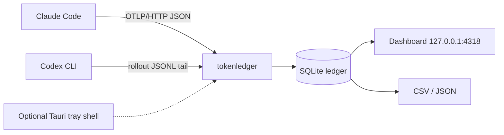

# token-literacy

A local-first token ledger for **Claude Code** and **OpenAI Codex CLI**. It separates fresh input, cache reads, cache writes, and output per turn, then shows the cache economics that a single "total tokens" number hides.

**Status: M1 collector live.** The Go collector ingests Claude Code OTLP telemetry into the SQLite ledger, with `setup`, `doctor`, and query APIs working. Codex rollout adapter (M2), dashboard charts (M3), and packaging (M4+) are planned in [`docs/PLAN.md`](docs/PLAN.md).

## Why

Agent sessions are dominated by context replay. Cache reads can be most of the prompt tokens while costing a fraction of fresh input; cache writes are an investment that only pays back if the next turn reuses them. Subscription plans hide those distinctions behind quota screens. This project makes them visible per turn, locally, without a proxy.

It also normalizes a real incompatibility:

| Harness | `input_tokens` includes cache? | Cache fields |
|---|---|---|
| Claude Code | No | `cache_read_tokens`, `cache_creation_tokens` |
| Codex CLI | Yes | `cached_input_tokens` is a subset of `input_tokens` |

Adding the cache figure to Codex input double-counts every cached token. The ledger refuses to do that.

## What it will show

- Per turn: uncached input (`U`), cache read (`R`), cache write (`W`), output (`O`).
- Cache hit rate `R / (U+R+W)`, fresh share `U / (U+R+W)`, context tax `(U+R+W) / O`.
- API-equivalent cost, cost per output token, and cache ROI.
- Claude Code vs Codex side by side, with the semantic difference made explicit.
- CSV/JSON export for reproducible article charts.

## Architecture



- **Go collector** (`cmd/tokenledger`, `internal/...`): OTLP receiver, Codex tailer, SQLite ledger, dashboard.
- **Claude Code**: per-request `claude_code.llm_request` spans over OTLP/HTTP JSON; setup writes the user-level `env` block.
- **Codex**: `token_usage_record` entries from `~/.codex/sessions/**/rollout-*.jsonl`; no configuration required.
- **Tauri v2** (M5): optional menu-bar/tray shell that supervises the same Go binary and opens the dashboard. The Go binary is complete without it.

## Interface

```bash
tokenledger setup [--dry-run] [--force] [--endpoint URL]   # configure Claude Code OTel (implemented)
tokenledger up [--port 4318] [--db PATH]                    # collector on 127.0.0.1 (implemented)
tokenledger doctor                                          # installation diagnostics (implemented)
tokenledger export --csv --since 7d                         # planned (M4)
tokenledger install | uninstall                             # per-user autostart (planned, M4)
```

HTTP surface: `POST /v1/traces`, `/v1/metrics`, `/v1/logs` (OTLP/HTTP JSON, gzip accepted), `GET /health`, `GET /api/summary`, `GET /api/rows`, `GET /api/sessions`. The dashboard (M3) and `/export.csv|json` land with M3.

## Scope

**v0.1:** Claude Code and Codex only; macOS and Windows; local SQLite; no proxy; no cloud; no accounts; no prompt content.

**Explicitly out of scope:** LiteLLM, OpenRouter, omp, OpenCode, Cursor, Copilot, team mode, hosted ingestion, and exact subscription billing. Cost is labelled **API-equivalent**, not billed spend.

## Privacy

The collector binds `127.0.0.1` only. It reads Claude Code telemetry and Codex rollout usage records, stores token counts and metadata, and never stores prompts, tool output, or message bodies. It makes no outbound network calls.

## Documentation

- [Implementation plan](docs/PLAN.md)
- [Architecture](docs/ARCHITECTURE.md)
- [Development process](docs/DEVELOPMENT_PROCESS.md)
- [ADRs](docs/adr/README.md)
- [Releasing](docs/RELEASING.md)
- [Security policy](SECURITY.md)

## Contributing

See [CONTRIBUTING.md](CONTRIBUTING.md). The project follows the [Contributor Covenant](CODE_OF_CONDUCT.md). Security reports go through GitHub private vulnerability reporting, never public issues.

## License

Apache-2.0. See [LICENSE](LICENSE).

Not affiliated with Anthropic or OpenAI. Claude Code and Codex are products of their respective owners.
